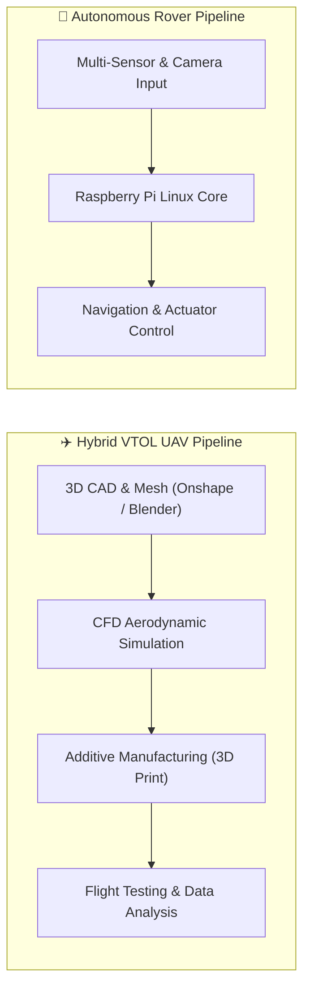

  <h1>Hectorasoobi</h1>
  
<strong>Software Engineering · Defense & Aerospace R&D · Embedded Robotics</strong>

  

    
    
    
  

---

### ⚡ Engineering & Development Focus

- ✈️ **VTOL Unmanned Aerial Vehicle (UAV) R&D** — Designing a hybrid vertical take-off & landing (VTOL) and fixed-wing cruise UAV within a 6-member engineering team; leading **CFD aerodynamic simulations**, **3D CAD/mesh modeling** (`Onshape`, `Blender`), **additive manufacturing (3D printing)**, and flight data analysis.
- 🔬 **R&D Lab & Academic Software Systems** — Supporting TÜBİTAK-funded research projects and engineering full-stack web tools that automate academic workflows and business-day calculations.
- 🤖 **Embedded Systems & Autonomous Robotics** — Developing a **Raspberry Pi-based Rover** platform integrating camera vision and multi-sensor arrays toward autonomous navigation.
- 🖥️ **Systems & Network Infrastructure** — Hands-on deployment of enterprise servers, router hardware platforms, network configuration, and **Debian Linux** environments.

---

### 🚀 Featured Engineering Projects

| Project | Architecture & Scope | Core Technologies |
| :--- | :--- | :--- |
| **✈️ SEMRUK VTOL UAV** | Hybrid VTOL & fixed-wing UAV airframe design, CFD aerodynamic optimization, 3D-printed structural prototyping, and telemetry analysis | `CFD` · `Onshape` · `Blender` · `3D Printing` · `Data Analysis` |
| **🧭 Interactive Internship & Workflow Suite** | Full-featured React & JavaScript web application with interactive decision wizard, holiday-adjusted business day engine, and document guides | `React` · `JavaScript` · `HTML5` · `CSS3` · `Node.js` |
| **🚌 LumiQ – Shuttle Queue Tracker** | Real-time shuttle queue monitoring mobile system integrating UI/UX design, relational database architecture, and live camera stream pipeline | `Mobile App` · `SQL Server` · `System Design` · `Live Stream` |
| **🤖 Raspberry Pi Autonomous Rover** | Modular wheeled robotics platform combining Raspberry Pi compute, camera feed processing, and ultrasonic/IR sensor fusion | `Raspberry Pi` · `C / Python` · `Linux` · `Sensors` |

---

### 📐 System Architecture Overview

---

### 🛠️ Tech Stack & Engineering Toolchain

**Languages, Web & Databases**

  
  
  
  
  
  
  

**CAD, CFD Simulation & Systems Infrastructure**

  
  
  
  
  
  
  

---

### 🏆 Robotics & Technical Competitions

- 🤖 **1st Place — VEX Robotics Competition** *(Robot design, assembly, and driver control — Provincial & School-wide)*
- 🥇 **1st Place — Entrepreneurship & Innovation Competition**
- 🏅 **3rd Place — FIRST LEGO League (FLL)** *(Free Project Category)*
